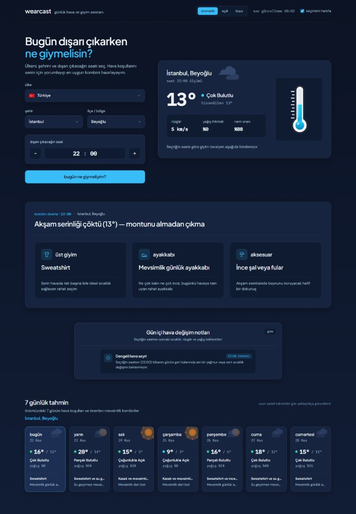
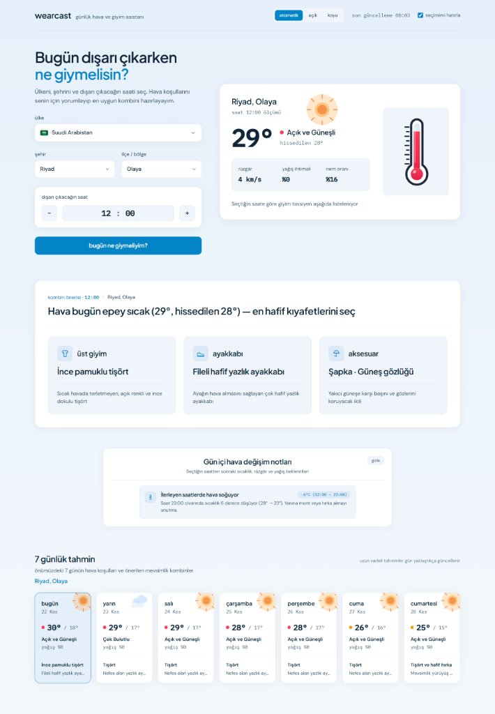
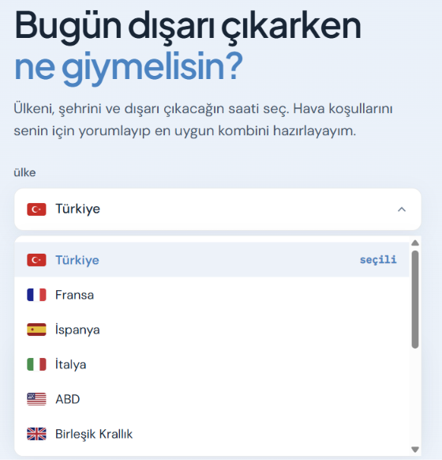

<div align="center">

# WearCast

**Günlük Hava ve Giyim Asistanı · Daily Weather & Outfit Assistant**

[English](#-english) · [Türkçe](#-türkçe) · [Screenshots](#-screenshots--ekran-görüntüleri)

</div>

---

## 📸 Screenshots / Ekran Görüntüleri

<table>
  <tr>
    <td align="center" width="50%">
      <strong>Dark Mode / Koyu Tema</strong><br/>
      <sub>İstanbul, Beyoğlu — 22:00 (13°C)</sub>
    </td>
    <td align="center" width="50%">
      <strong>Light Mode / Açık Tema</strong><br/>
      <sub>Riyad, Olaya — 12:00 (29°C)</sub>
    </td>
  </tr>
  <tr>
    <td align="center">
      
    </td>
    <td align="center">
      
    </td>
  </tr>
</table>

<div align="center">
  <br/>
  
  <br/>
  <sub><strong>Country & Location Picker / Ülke ve Konum Seçici</strong></sub>
</div>

---

## 🇬🇧 English

**WearCast** is a modern web application that turns real-time weather forecasts into practical, hour-specific outfit recommendations. Pick your country, city, district, and departure time — WearCast analyzes temperature, "feels like" temperature, wind speed, humidity, and rain probability to suggest what to wear.

### Key Features

- **Smart Outfit Engine (`outfitEngine`)**: Recommends upper wear, footwear, and accessories tailored to exact weather conditions.
- **Intraday Weather Alerts**: Highlights upcoming temperature drops, wind shifts, or rain after your chosen departure hour.
- **7-Day Outlook**: Displays daily min/max temperatures, precipitation probability, and quick outfit summaries for the week ahead.
- **Turkey & World Locations**: Built-in location support with automatic coordinate resolution via Open-Meteo Geocoding API.
- **Adaptive Theme**: Supports automatic, light, and dark modes with a live animated weather & thermometer stage.
- **Zero API Keys Needed**: Powered by [Open-Meteo](https://open-meteo.com/) Weather & Geocoding APIs with `localStorage` caching.

### Tech Stack

- **React 18** & **Vite 6**
- **Tailwind CSS v4** (`@tailwindcss/vite`)
- **Open-Meteo API** (Weather & Geocoding)

### Getting Started

```bash
git clone https://github.com/<your-username>/wearcast.git
cd wearcast
npm install
npm run dev
```

For a production build:

```bash
npm run build
npm run preview
```

---

## 🇹🇷 Türkçe

**WearCast**, anlık ve saatlik hava durumu verilerini pratik giyim tavsiyelerine dönüştüren modern bir web uygulamasıdır. Ülkenizi, şehrinizi, ilçenizi ve dışarı çıkacağınız saati seçin; WearCast sıcaklık, hissedilen sıcaklık, rüzgâr hızı, nem ve yağış ihtimalini yorumlayarak size en uygun kombini önersin.

### Öne Çıkan Özellikler

- **Akıllı Giyim Motoru (`outfitEngine`)**: Hava koşullarına göre üst giyim, ayakkabı ve aksesuar önerileri üretir.
- **Gün İçi Hava Değişim Notları**: Seçtiğiniz saatten sonra yaşanacak ani sıcaklık düşüşlerini, rüzgâr veya yağış beklentilerini önceden haber verir.
- **7 Günlük Tahmin**: Önümüzdeki hafta için günlük en yüksek/en düşük sıcaklıkları, yağış oranını ve özet kombinleri sunar.
- **Türkiye ve Dünya Konumları**: Hazır konum listeleri ve Open-Meteo Geocoding API ile ilçe/bölge bazlı koordinat çözümlemesi yapar.
- **Uyarlanabilir Tema**: Otomatik, açık ve koyu tema seçeneklerinin yanı sıra animasyonlu hava sahnesi ve termometre göstergesi içerir.
- **API Anahtarı Gerektirmez**: Ücretsiz [Open-Meteo](https://open-meteo.com/) Weather ve Geocoding API'lerini kullanır ve verileri tarayıcıda önbelleğe alır.

### Kullanılan Teknolojiler

- **React 18** & **Vite 6**
- **Tailwind CSS v4** (`@tailwindcss/vite`)
- **Open-Meteo API** (Hava durumu & Geocoding)

### Kurulum

```bash
git clone https://github.com/for-discovery/wearcast.git
cd wearcast
npm install
npm run dev
```

Üretim (production) derlemesi için:

```bash
npm run build
npm run preview
```

---

<details>
<summary><strong>📁 Project Structure / Proje Yapısı</strong></summary>

```text
wearcast/
├── docs/screenshots/   # README preview images / Ekran görüntüleri
├── src/
│   ├── components/     # UI components (Thermometer, Hourly/Weekly forecast, Alerts, etc.)
│   ├── data/           # Turkey & world location datasets
│   ├── engine/         # Outfit recommendation engine
│   ├── services/       # Open-Meteo API, geocoding & localStorage caching
│   ├── App.jsx
│   └── main.jsx
├── index.html
├── package.json
└── vite.config.js
```

</details>
